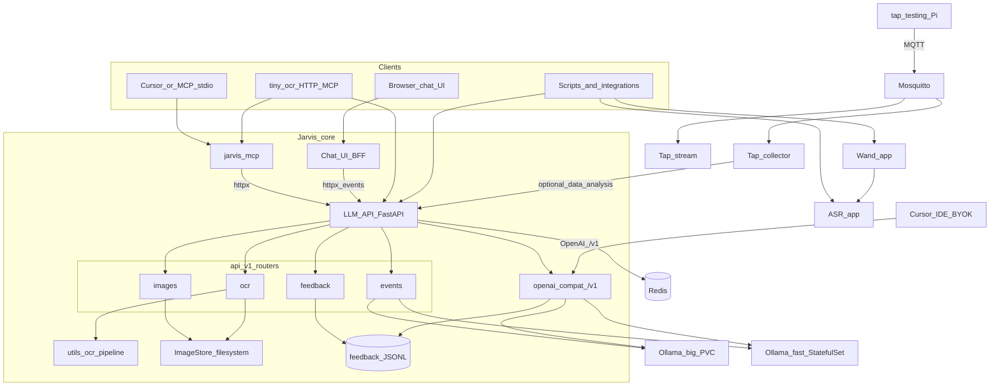
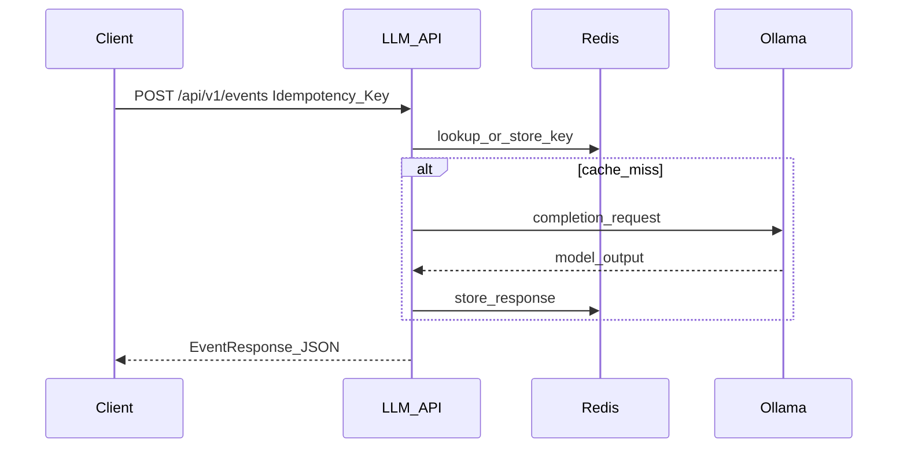
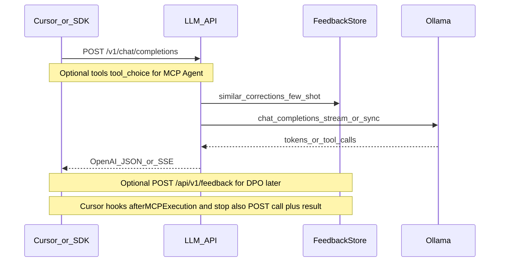
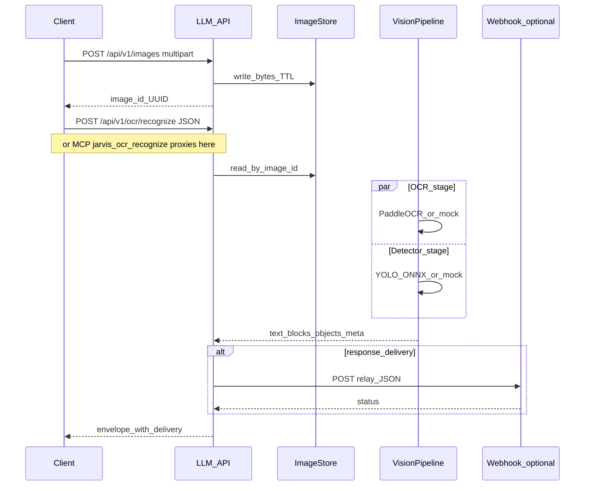
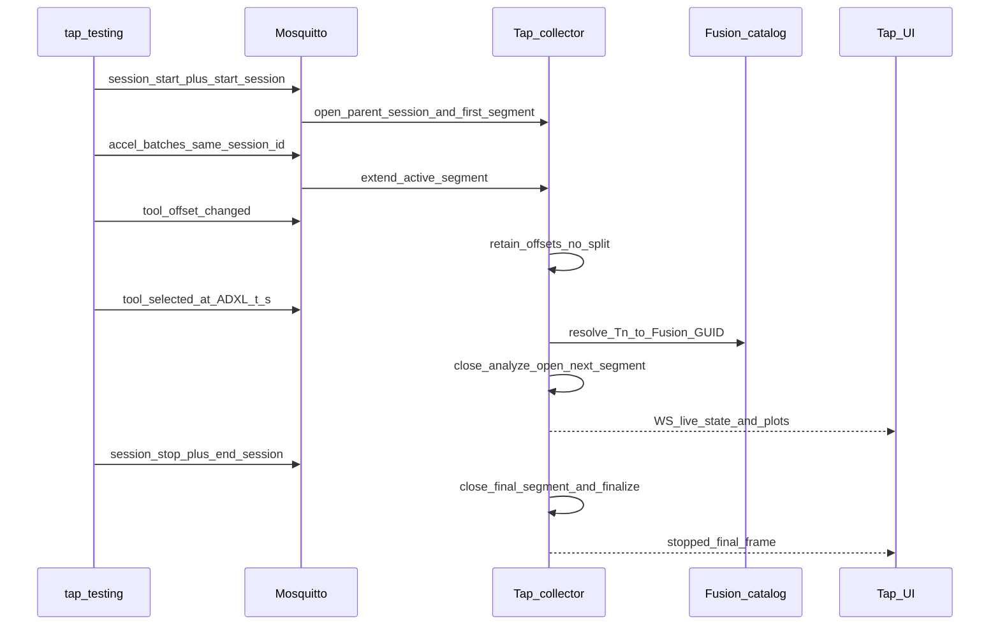
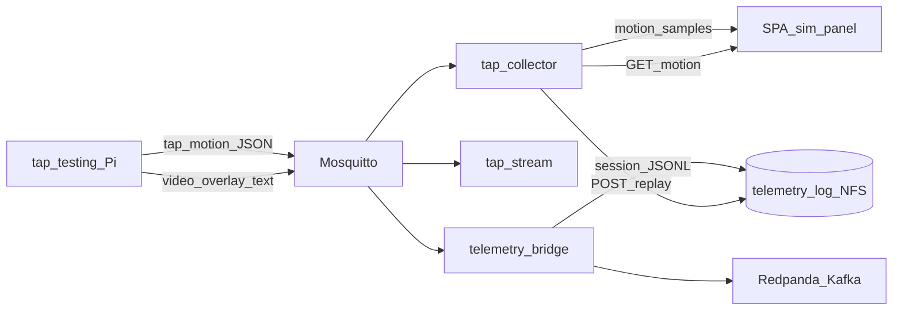

# Architecture

Jarvis is a **multi-service** system: a root **LLM API** (FastAPI), optional **ASR**, **chat UI**, **Ollama** (or other model backends), **Redis** for shared idempotency, and an **MCP bridge** that exposes the same HTTP contracts to agent hosts. **OCR and object detection** run inside the LLM API process: ephemeral images on disk, a dual-stage **vision pipeline** (text + mandatory detector), and optional **client-directed webhooks** for results.

---

## Deployment view

High-level processes and dependencies (typical Docker Compose or Kubernetes layout).

| Component | Role |
| --------- | ---- |
| **LLM API** | Single FastAPI app: **`LLMHandler`** for chat/event completion, **OpenAI-compat `/v1`**, **feedback** store, **idempotency**, **image upload**, **OCR**, **`GET /metrics`**, request ID middleware. |
| **Redis** | Optional backing store for **`Idempotency-Key`** replay on **`POST /api/v1/events`** and OCR recognize / image uploads (same abstraction). |
| **Ollama** | OpenAI-compatible HTTP; default big tier **`llama3.1:8b`** (pinned **`ollama/ollama:0.4.7`**); fast tier **`llama3.2:3b`**. Models on PVCs (fridge NFS in the gpu-rig overlay). **`gpt-oss:20b`** is the post-bump target. Optional tuned tag via **`MODEL_NAME_TUNED`**. |
| **ASR** | Separate FastAPI app and lifecycle; **WebSocket** **`/api/v1/stream`** for **audio** only (see [ASR streaming](../asr-streaming.md)). **Not** used for OCR or object detection. |
| **Wand** | Separate FastAPI app (`wand/`, port **8002**): tip trajectories + incantation lexicon/fusion → **`spell_cast`** for park-station effects (see [Wand](../wand/index.md)). Pi/ESP32 edge clients stream points; gesture SVM or heuristics on server. |
| **Tap collector** | Optional FastAPI app (`tap_collector/`, port **8004**, Compose profile **`telemetry`**): MQTT ingest from sibling **tap-testing**, parent-session live recording with tool-bound segments + offset provenance, idle/fault finalize (empty sessions + optional max wall-clock; edge ADXL idle watchdog emits `end_session`), session/tool CRUD, **persisted MQTT event JSONL** (30d retention on session PVC), **motion_samples** from `tap/…/motion`, replay sim SPA panel, live Modbus → measured/commanded `rpm_samples` (transition-window exclusions), CSV/ZIP run-bundle import + `/ui/` SPA (session WebSocket, RPM timeline), Fusion library resolution (RRF `Tn` ↔ Fusion post number; import upsert + number-eviction / optional full replace), live FFT, per-segment resonance / RPM analytics, optional LLM `data_analysis` forward; gpu-rig-telemetry stores sessions on fridge NFS (see [Tap collector](../services/tap-collector.md)). |
| **Tap stream** | Optional ffmpeg/RTMP service (`tap_stream/`, port **8005**): subscribes MQTT `session`, `video_overlay`, `accel/batch` for YouTube live from Pi MJPEG (see [Tap stream](../services/tap-stream.md)). |
| **Mosquitto** | Optional MQTT broker (Compose profile **`telemetry`**, port **1883**) for tap telemetry topics. TLS/ACL hardening: `k8s/mosquitto/mosquitto-tls.conf` + `acl.example`. |
| **Chat UI** | Separate FastAPI BFF (`ui/`, port **8003**): static SPA + **`POST /api/chat`** → LLM events; thumbs / corrections → **`/api/v1/feedback`**; **Learning** view for feedback correctness (summary / list / detail); Big/Fast tier toggle (see [Chat UI](../api/ui.md)). |
| **Cluster DNS** | Optional LAN-facing CoreDNS (`k8s/cluster-dns/`, MetalLB **`:53`**) authoritative for **`jarvis.lan`**; pinned service IPs so clients use names instead of shifting LoadBalancer addresses (see [Cluster DNS](../operations/cluster-dns.md)). Unrelated to in-cluster **`*.svc.cluster.local`**. |
| **`jarvis_mcp`** | Out-of-process MCP server: tools call the **LLM API** over HTTP (`stdio`, **`streamable-http`**, or **`both`**). OCR tools hit the same **`/api/v1`** base as events. |
| **Vision pipeline** | **`utils/ocr/`**: decode + resize cap, **PaddleOCR** (or **`mock`** in CI), **ONNX YOLO** detector (or **`mock`**), **`asyncio.gather`** for parallel stages, optional **`response_delivery`** relay with SSRF checks. |

---

## Workflow: LLM event (existing path)

Idempotency is **body-hash scoped**: the same key with a different JSON body returns **409**.

---

## Workflow: OpenAI-compat chat (Cursor)

See [OpenAI-compatible API](../api/openai-compat.md) (including [tool calling](../api/openai-compat.md#tool_calling)), [Fusion 360 MCP + local Jarvis](../operations/fusion360-mcp.md), and [Feedback and fine-tuning](../operations/feedback-and-finetune.md). Fusion / CAM coaching trajectories use feedback domain **`cad`** (dataset **`training/datasets/cad/`**).

---

## Workflow: OCR and object recognition

Upload uses **REST** (binary); recognition uses **REST** and/or **MCP** with the same JSON body on **`POST /api/v1/ocr/recognize`**. That keeps firmware and agents on one contract without embedding large base64 blobs in MCP JSON when the UUID flow is used.

**Response envelope:** `request` (correlation, `image_id`, `prompt`), `result` (**`text`**, **`blocks`**, **`objects`** mandatory array), `meta` (engine, latency, detector errors if partial success), **`delivery`** (webhook attempt result or `attempted: false`).

---

## Workflow: tap tool-segment analytics

Legacy or live ADXL recordings are correlated with the Fusion tool library via time segments, then analyzed for predicted tooth-pass resonance risk and (when RPM telemetry exists) relative good/bad observed speeds.

Import path (ZIP/CSV) still seeds segments from `tool-events.jsonl` when no live segments exist, then the SPA can `PUT` edits and reanalyze. Live finalize persists NPZ like imports. Job enrichment prefers `tap/#` over `cam/#` (4th-combinator sim) over Duet. When `job_file` is present, the collector resolves the G-code on the read-only CAM NFS mount (`/cam-gcode`, same content as RRF `gcodes → /mnt/CAM/`) and stores a summary + `source_ref` (no file copy). Live ArborCTL samples (`tap/{device}/spindle`) and leftover Modbus rows (recording-relative `t_s`) normalize into `rpm_samples`; `arborctl` / `measured_modbus` / `manual` drive observed good/bad rankings (excluding tool-change / spindle start-stop windows); commanded RRF/Modbus, `rrf_spindle`, and `fusion_reference` are contextual. H100 load % is stored as `load_samples` when `power_available`. G-code `S` timing and full CAM simulation remain future work. See [Tap collector — live recording](../services/tap-collector.md#live_recording), [CAM G-code](../services/tap-collector.md#cam_gcode), and [tool segments](../services/tap-collector.md#tool_segments).

---

## Telemetry replay and durable log {#telemetry_replay}

Live tap telemetry uses **MQTT at the edge** (Pi / Duet / CAM sim → Mosquitto). For **session replay** after crash, time-scrub UI, and multi-consumer analytics, the gpu-rig **telemetry** overlay adds a **durable log** without replacing MQTT publishers.

| Component | Role |
| --------- | ---- |
| **tap/…/motion** | Structured XYZ(A) from Pi `rr_model` poll — **tap_collector** sim/replay (not tap-stream) |
| **video_overlay** | HUD text for **tap-stream** ffmpeg / YouTube only |
| **telemetry_bridge** | MQTT → Kafka topic `jarvis.telemetry.tap` + per-session JSONL (`accel`, `motion`) on NFS |
| **Redpanda** | Single-node Kafka API on gpu-rig-telemetry for PoC replay / second consumers |
| **POST …/replay** | Rehydrate `motion_samples` from bridge JSONL (`TAP_COLLECTOR_TELEMETRY_LOG_DIR`) |

### Replay gaps (MQTT-only baseline)

| Gap | Today | With durable log |
|-----|-------|------------------|
| Raw accel after collector crash | In-memory batches until finalize | Bridge retains full `accel/batch` |
| MQTT event JSONL | Summarized array lengths | Bridge stores raw payloads |
| XYZ sim replay | None (`file_position` only on Duet) | `motion` topic + `GET …/motion` |
| Second consumer (ML export) | Coupled to collector | Independent Kafka consumer group |

Future **Klipper/Moonraker** uses `print/{device}/motion` with the same envelope — see [Klipper telemetry](../services/klipper-telemetry.md).

---

## Data and configuration boundaries

| Concern | Where it lives | Notes |
| ------- | -------------- | ----- |
| **Chat / event state** | `LLMHandler` in-memory **`events_store`**, idempotency records | **`GET /events/{id}`** reads **process-local** state only (not replicated across replicas). Use **Redis idempotency** + **`POST` replay** for durable client semantics. |
| **Ephemeral images** | Filesystem **`JARVIS_IMAGE_DIR`**, TTL **`JARVIS_IMAGE_TTL_S`** | Sidecar JSON per image for expiry; recognize deletes are optional (`DELETE /images/{id}`). |
| **Detector weights** | Path **`JARVIS_OCR_YOLO_ONNX_PATH`** | Missing file → health **`degraded`**; recognize may still return OCR with **`objects: []`** and **`meta.detector_error`**. |
| **OTA model bytes** | **`GET /api/v1/ocr/models/{name}`** | Directory **`JARVIS_OCR_MODELS_DIR`** (e.g. tiny-ocr TFLite). |

---

## MCP transport modes

| Mode | When to use |
| ---- | ----------- |
| **`stdio`** | Cursor, CLI, local agent hosts (default). |
| **`streamable-http`** | Remote or embedded HTTP MCP clients (e.g. Compose service on **8765**). |
| **`both`** | Uvicorn for streamable HTTP in a **background thread** + **stdio** foreground (same process). |

DNS rebinding and bearer auth for HTTP MCP are called out in **[MCP bridge](../mcp.md)** and **[OCR service](../services/ocr.md)**.

---

## Related documentation

- **[OCR service (spec)](../services/ocr.md)** — normative REST + MCP fields, relay, revision history.
- **[MCP tool payloads](../mcp-payloads.md)** — per-tool HTTP mapping and return shapes.
- **[LLM events API](../api/llm-events.md)** — event contract and idempotency semantics.
- **[SLOs and expectations](../guides/slos.md)** — qualitative latency and durability notes.
