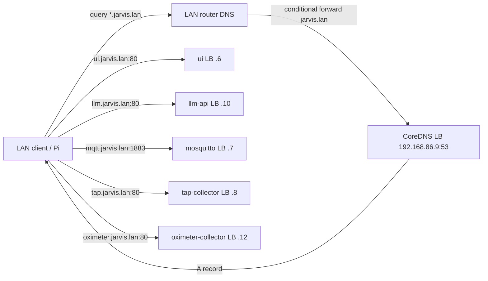

# Cluster LAN DNS (`jarvis.lan`)

Jarvis exposes a small **LAN-facing** CoreDNS instance so clients outside the
cluster can reach services by stable names instead of MetalLB IPs that may
change when a Service is recreated.

This is **separate** from in-cluster pod DNS (`kube-system` CoreDNS /
`*.svc.cluster.local`). Pods keep using Kubernetes Service names; LAN clients
use `*.jarvis.lan`.

## Architecture



| Piece | Role |
| ----- | ---- |
| **`k8s/cluster-dns/`** | CoreDNS Deployment + ConfigMap (Corefile + zone) + ClusterIP Service |
| **`k8s/overlays/gpu-rig-dns/`** | Patches Service to MetalLB **`192.168.86.9`** in namespace **`jarvis-llm`** |
| Service LB patches | Pin ui / mosquitto / tap-collector / oximeter-collector / llm-api to **`.6` / `.7` / `.8` / `.12` / `.10`** |

Zone **`jarvis.lan`** avoids **`.local`**, which collides with mDNS / Avahi.

## Stable IPs and names

IPs must stay inside the MetalLB pool (**`192.168.86.3`–`29`** on this cluster).
The pool itself is operator-managed (not in this repo).

| Name | IP | Port | Service |
| ---- | -- | ---- | ------- |
| `ns.jarvis.lan` / `dns.jarvis.lan` | `192.168.86.9` | 53 UDP/TCP | `cluster-dns` |
| `ui.jarvis.lan` / `chat.jarvis.lan` | `192.168.86.6` | 80 | `ui` |
| `mqtt.jarvis.lan` | `192.168.86.7` | 1883 | `mosquitto` |
| `tap.jarvis.lan` / `tap-collector.jarvis.lan` | `192.168.86.8` | 80 | `tap-collector` |
| `oximeter.jarvis.lan` / `oximeter-collector.jarvis.lan` | `192.168.86.12` | 80 | `oximeter-collector` (namespace **`health`**) |
| `llm.jarvis.lan` / `openai.jarvis.lan` / `api.jarvis.lan` | `192.168.86.10` | 80 | `llm-api` |

(DNS uses **`.9`**, not **`.5`**: MetalLB still associates **`.5`** with the old
`tap-collector` LoadBalancer sharing key even after tap moved to **`.8`**.)

The HTTP LoadBalancers listen on port **80** and forward to their applications'
internal ports (**8000**, **8003**, and **8004**), so browsers do not need an explicit
port. (Overlays replace `spec.ports` with a JSON6902 patch — Service ports merge
on the port number, so a plain strategic-merge of `8003`→`80` would leave two
entries both named `http`.) The **`gpu-rig-llm`** overlay keeps **port 8000** on
**`llm-api`** as well (**`http-direct`**) so in-cluster clients that use
**`http://llm-api:8000`** (UI, ASR, tap-collector) keep working alongside LAN **:80**.
MQTT stays on its own IP because it is raw TCP;
**1883** is the standard unencrypted MQTT port and clients normally use it by
default.

## Apply (operator)

```bash
# Pin existing LBs (if not already applied with the annotations):
kubectl apply -k k8s/overlays/gpu-rig-ui/
kubectl apply -k k8s/overlays/gpu-rig-telemetry/
kubectl apply -k k8s/overlays/gpu-rig-llm/   # llm.jarvis.lan → OpenAI /v1

# LAN DNS server:
kubectl apply -k k8s/overlays/gpu-rig-dns/
```

Confirm the EXTERNAL-IP is pinned:

```bash
kubectl -n jarvis-llm get svc cluster-dns ui mosquitto tap-collector llm-api
```

## Point the LAN at CoreDNS

Pick one:

1. **Preferred — conditional forward on the router / Pi-hole / Unbound / dnsmasq**  
   Forward only the zone **`jarvis.lan`** to **`192.168.86.9`**. All other queries keep using the router’s normal upstream.

2. **Client DNS** — set a laptop/Pi resolver to **`192.168.86.9`**. CoreDNS forwards non-`jarvis.lan` queries to **`192.168.86.1`** and **`1.1.1.1`** (see Corefile).

Do **not** use **`.local`** as the zone name.

## Verify

```bash
dig @192.168.86.9 ui.jarvis.lan +short
# expect: 192.168.86.6

dig @192.168.86.9 mqtt.jarvis.lan +short
# expect: 192.168.86.7

dig @192.168.86.9 tap.jarvis.lan +short
# expect: 192.168.86.8

curl -sS http://ui.jarvis.lan/health
curl -sS http://tap.jarvis.lan/health
```

After the router forward is in place, omit `@192.168.86.9` and use the system resolver.

### Client examples

```bash
# Chat UI
open http://ui.jarvis.lan

# Tap collector SPA
open http://tap.jarvis.lan/ui/

# tap-testing Pi MQTT
export TAP_MQTT_HOST=mqtt.jarvis.lan
export TAP_MQTT_PORT=1883
```

## Zone file and hot reload

Authoritative data lives in ConfigMap **`jarvis-cluster-dns`**
(source: repo path `k8s/cluster-dns/configmap.yaml`; mounted at `/etc/coredns`).

Corefile essentials:

```text
.:53 {
    errors
    health
    ready
    log
    file /etc/coredns/jarvis.lan.zone jarvis.lan
    forward . 192.168.86.1 1.1.1.1
    cache 30
    reload 10s
}
```

To add a name:

1. Pin the Service with annotation `metallb.universe.tf/loadBalancerIPs: "<ip>"`.
2. Add an `A` record in the `jarvis.lan.zone` key of the ConfigMap (bump the SOA serial).
3. Apply the overlay / ConfigMap. CoreDNS **`reload 10s`** picks up zone changes without a pod restart for file edits under the mount; ConfigMap updates typically remount within tens of seconds.

## Related overlays

| Overlay (repo path) | What it exposes |
| ------------------- | --------------- |
| `k8s/overlays/gpu-rig-dns/` | CoreDNS on `.9` |
| `k8s/overlays/gpu-rig-ui/` | Chat UI on `.6` |
| `k8s/overlays/gpu-rig-telemetry/` | Mosquitto `.7` + tap-collector `.8` |

See also [Kubernetes](kubernetes.md).
