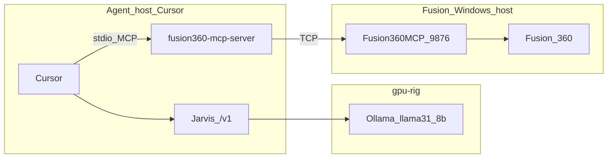

# Fusion 360 MCP + local Jarvis

Drive Autodesk Fusion 360 CAD from **Cursor Agent** using the local Jarvis LLM (`llama3.1:8b` via Ollama) and the community [fusion360-mcp-server](https://github.com/faust-machines/fusion360-mcp-server) (PyPI: `fusion360-mcp-server`).

Jarvis does **not** host Fusion tools. Cursor runs two sides:

1. **LLM** — Override OpenAI Base URL → Jarvis **`/v1`** (with [tool calling](../api/openai-compat.md#tool_calling))
2. **MCP** — `uvx fusion360-mcp-server --mode socket` → TCP bridge into the Fusion add-in



## Prerequisites

- Jarvis LLM LAN endpoint (`llm.jarvis.lan` / `192.168.86.10`) — see [OpenAI-compatible API](../api/openai-compat.md#cursor)
- Autodesk Fusion 360 on a **trusted LAN** host
- [uv](https://docs.astral.sh/uv/) on the agent host
- MCP client: Cursor (or any MCP host that sends OpenAI `tools` to Jarvis)

## Fusion host (Windows)

Cross-machine setup: Fusion and Cursor are on **different** machines.

1. Install the **Fusion360MCP** add-in (from the [upstream repo](https://github.com/faust-machines/fusion360-mcp-server) `addon/` folder) into:

   `%APPDATA%\Autodesk\Autodesk Fusion 360\API\AddIns\Fusion360MCP`

2. Before starting Fusion, bind the TCP bridge on all interfaces (trusted LAN only — **no authentication**):

   ```powershell
   $env:FUSION_MCP_HOST = "0.0.0.0"
   ```

3. Start Fusion → **Shift+S** → Add-Ins → **Fusion360MCP** → **Run**. Confirm in TEXT COMMANDS:

   `Server listening on 0.0.0.0:9876`

4. Allow inbound **TCP 9876** from the agent host only (Windows Firewall).

## Agent host (Cursor)

### Jarvis as the model

1. Override OpenAI Base URL → `http://llm.jarvis.lan/v1` (or `http://192.168.86.10/v1`)
2. API key = **`JARVIS_OPENAI_API_KEY`** (gpu-rig default `jarvis-lan-openai`)
3. Add / select model alias e.g. **`llama31-8b`**

### Fusion MCP config

In `~/.cursor/mcp.json` (or project `.cursor/mcp.json`):

```json
{
  "mcpServers": {
    "fusion360": {
      "command": "uvx",
      "args": [
        "--from",
        "git+https://github.com/faust-machines/fusion360-mcp-server",
        "--with",
        "mcp<2",
        "fusion360-mcp-server",
        "--mode",
        "socket"
      ],
      "env": {
        "FUSION_MCP_HOST": "<fusion-host-lan-ip>"
      }
    }
  }
}
```

Replace `<fusion-host-lan-ip>` with the Windows machine’s LAN address (not `0.0.0.0`).

**Why git + `mcp<2`:** PyPI `0.1.0` ignores `FUSION_MCP_HOST` (always `localhost`). Fresh `uvx` also resolves MCP Python SDK 2.x, which removed `@Server.list_tools()` and crashes the server on start (`AttributeError: 'Server' object has no attribute 'list_tools'`). Git tip honors the host env; `--with mcp<2` keeps the decorator API the server still uses.

Optional: keep the existing **`jarvis`** MCP entry alongside for `jarvis_log_outcome` / feedback (`domain: "cad"` — formal Learning UI / few-shot slice; see [Feedback and fine-tuning](feedback-and-finetune.md)).

## Verify

1. From Cursor, call the Fusion MCP **`ping`** tool → expect `{"ok": true, "status": "pong"}` (or equivalent pong payload).
2. Smoke CAD: **`get_scene_info`** or **`create_box`** via Agent with Jarvis selected.
3. Optional API check that Jarvis tool calling is live:

```bash
curl -s http://llm.jarvis.lan/v1/chat/completions \
  -H "Authorization: Bearer jarvis-lan-openai" \
  -H "Content-Type: application/json" \
  -d '{
    "model": "llama31-8b",
    "messages": [{"role": "user", "content": "Call the ping tool"}],
    "tools": [{
      "type": "function",
      "function": {
        "name": "ping",
        "description": "Health check",
        "parameters": {"type": "object", "properties": {}}
      }
    }]
  }'
```

Expect **`finish_reason": "tool_calls"`** and a `tool_calls` entry named `ping`.

## Tips

- Fusion allows **one operation per tool call**; do not batch mutations. Prefer clients that set **`parallel_tool_calls: false`**.
- Upstream exposes ~90 tools — start from Fusion MCP **prompts** (`create-box`, etc.) so the 8B model is not drowned in schemas. Curated DPO pairs: **`training/datasets/cad/`** (`python -m training.build_cad_dataset`); golden **`training/golden/cad.jsonl`**.
- After a Fusion **TIMEOUT**, call **`get_scene_info`** before retrying mutations (upstream never auto-retries).
- TCP bridge has **no auth** — only bind `0.0.0.0` on a private LAN.

## Related

- [OpenAI-compatible API — tool calling](../api/openai-compat.md#tool_calling)
- [Cursor on the LAN](../api/openai-compat.md#cursor)
- [Cursor tunnel fallback](cursor-tunnel.md)
- Upstream: [faust-machines/fusion360-mcp-server](https://github.com/faust-machines/fusion360-mcp-server)
